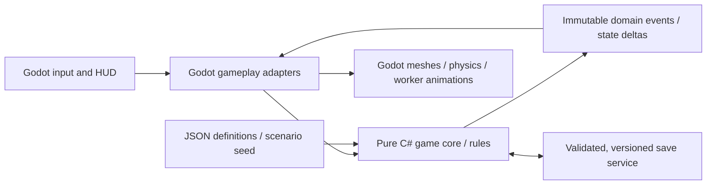

# Technical architecture — Godot 4.7.2 .NET / C#

## Project skeleton (desired implementation repo)
```text
webwild/
├── project.godot
├── Webwild.csproj                      # Godot.NET.Sdk/4.7.2, net10.0, enable dynamic loading
├── Webwild.sln
├── scenes/
│   ├── Main.tscn                      # bootstrap/menu/scene switch
│   ├── GardenClearing.tscn            # authored world / anchors / paths
│   ├── PlayerSpider.tscn              # CharacterBody3D + camera rig
│   ├── WorkerSpider.tscn              # worker presentation and navigation
│   ├── CaptureWeb.tscn / BridgeWeb.tscn
│   ├── Insect.tscn / LeafNursery.tscn / WindEvent.tscn
│   └── ui/{Title,HUD,WebBuilder,Nursery,Pause,Victory}.tscn
├── src/
│   ├── Core/                         # NO Godot references: model/rules/simulation/validation
│   ├── Game/                         # Godot adapters, event integration, presentation
│   ├── UI/                           # Godot Controls/UI screens
│   └── Infrastructure/               # JSON persistence, files, clock/seed adapters
├── tests/
│   ├── Webwild.Core.Tests/            # xUnit or NUnit; pure deterministic tests
│   └── Runtime/                       # Godot scene smoke/acceptance test runner
├── data/                               # JSON definitions, seed, missions
├── assets/                             # imported glb/svg/png and original source
├── docs/                               # developer and acceptance documentation
└── .github/workflows/                 # build, pure tests, Godot headless checks
```

## Data flow


## Pure core should own
`ResourceLedger` (non-negative food/silk, atomic spend/refund); `AnchorRules`/`WebPlacementRules`; `WebNetworkGraph` (stable typed IDs, no implicit teleport); `InsectPathPlan` and capture event idempotency; `TaskAssignmentPlanner`; `MissionProgress`; `WindDamageRules`; `SaveState` schema and validation. A fixed-step simulation tick (recommend 0.2 s) means deterministic scenario tests without frame timing or sleeping.

## Godot adapters should own
CharacterBody3D movement, camera spring arm, physics queries, clickable anchor and interactable `Area3D` masks, visual rope/tube meshes for web strands, capture `Area3D`, presentation/particles/UI, animation, audio, importing GLB. `InputMap` actions are declared in project settings, not magic key constants buried in C#.

## Web geometry boundaries
Never create physics collision per decorative silk strand. Use generated `ArrayMesh` or `ImmediateMesh`/`MeshInstance3D` for visible radial rings and safe shader/material; one abstract `Area3D` capture volume for capture web. Bridge uses a validated walkable `StaticBody3D`/simple capsule connection and a corresponding worker graph edge. Visual complexity can rise independently of simulation cost.

## Worker navigation
Represent key positions (nest, capture webs, bridge ends and anchor sockets) as a small graph. Edge types = `Ground`, `ClimbLink`, `SilkBridge`; cost includes travel distance. Godot nav agents can handle short local ground motion; graph remains authority for route availability and bridge reachability. No deep reinforcement learning, costly dynamic NavMesh baking or every-frame A* across the scene.

## Repeatability and performance
Use seeded RNG for insect spawn decisions and time-based fixed step; scripted scenario probes drive the same event sequences each time. Use a single source of truth for each entity ID. Avoid `Process` allocations proportional to all historical captures; pool meshes/FX as appropriate. Aim for 60 fps at 1080p on a mainstream desktop, minimum 30 fps on modest integrated graphics; verify with profiling, not assertion.

## Technical compatibility notes
- `Godot.NET.Sdk/4.7.2` is a published package. Godot 4.7.2 stable has separate .NET editor/export binaries.
- Check actual executable: some distributions name the Godot .NET binary `Godot_v4.7.2-stable_mono_linux.x86_64` rather than `godot`. Use the actual path; do not run Standard and falsely expect C# to load.
- Godot 4 C# does NOT export to web. Do not promise an HTML5 deliverable.
- Prefer engine-native formats and no paid asset/plugins. Optional external dependencies must be documented, pinned and licensed.
